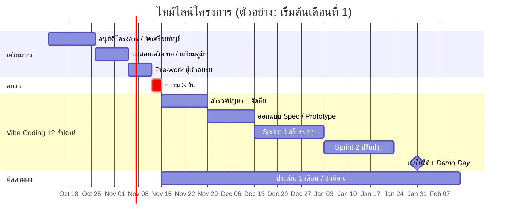

<div align="center">

# โครงการอบรมเชิงปฏิบัติการ
# AI Agent เพื่อการทำงานของครู
### *Claude Cowork · Claude Code · Codex และ AI Agent อื่นๆ*

**หลักสูตร 3 วัน (18 ชั่วโมง) + โครงการต่อเนื่อง "AI Vibe Coding"**

*ลดภาระงานเอกสาร เพิ่มเวลาให้การสอน*

---

เสนอ **หัวหน้าแผนก** · จัดทำโดย พิฆเนศ แสงสะเดาะ · ตุลาคม 2569

</div>

---

## สารบัญ

1. [สรุปสำหรับผู้บริหาร](#1-สรุปสำหรับผู้บริหาร)
2. [ที่มาและเหตุผล](#2-ที่มาและเหตุผล)
3. [วัตถุประสงค์และตัวชี้วัด](#3-วัตถุประสงค์และตัวชี้วัด)
4. [กลุ่มเป้าหมายและการเตรียมความพร้อม](#4-กลุ่มเป้าหมายและการเตรียมความพร้อม)
5. [เครื่องมือที่ใช้ในการอบรม](#5-เครื่องมือที่ใช้ในการอบรม)
6. [โครงสร้างหลักสูตร 3 วัน](#6-โครงสร้างหลักสูตร-3-วัน)
7. [ผลงานที่ครูได้กลับไปใช้จริง](#7-ผลงานที่ครูได้กลับไปใช้จริง)
8. [โครงการต่อเนื่อง AI Vibe Coding](#8-โครงการต่อเนื่อง-ai-vibe-coding)
9. [ธรรมาภิบาลและความปลอดภัยของข้อมูล](#9-ธรรมาภิบาลและความปลอดภัยของข้อมูล)
10. [การวัดผลและประเมินผล](#10-การวัดผลและประเมินผล)
11. [ทรัพยากร งบประมาณ และความเสี่ยง](#11-ทรัพยากร-งบประมาณ-และความเสี่ยง)
12. [ไทม์ไลน์โดยรวม](#12-ไทม์ไลน์โดยรวม)
13. [สิ่งที่ขออนุมัติ](#13-สิ่งที่ขออนุมัติ)
14. [ภาคผนวก](#14-ภาคผนวก)

---

## 1. สรุปสำหรับผู้บริหาร

> **แนวคิดหลัก:** ไม่ใช่การสอน "วิธีคุยกับ AI" แต่คือการสอน **"วิธีมอบหมายงานให้ AI ทำงานแทนอย่างเป็นระบบ"** โดยครูเป็นผู้ตรวจสอบและตัดสินใจขั้นสุดท้ายเสมอ

| หัวข้อ | รายละเอียด |
|---|---|
| **รูปแบบ** | Workshop แบบ Learning-by-Doing สัดส่วนปฏิบัติ ≥ 70% |
| **ระยะเวลา** | 3 วัน (วันละ 6 ชั่วโมง รวม 18 ชั่วโมง) |
| **จำนวนผู้เข้าอบรม** | 20–30 คน ต่อรุ่น (แนะนำ ≤ 30 เพื่อการดูแลอย่างทั่วถึง) |
| **ผลลัพธ์ที่จับต้องได้** | แผนการสอน/แผนจัดการเรียนรู้ ใบงาน แบบประเมิน และ **ระบบช่วยงานครูอย่างง่าย 1 ชิ้น** ต่อคน |
| **ต่อยอด** | โครงการ AI Vibe Coding 12 สัปดาห์ สร้างระบบจริงใช้งานในแผนก |
| **เป้าหมายเชิงผลลัพธ์** | ลดเวลางานเอกสารซ้ำซ้อนของครูอย่างน้อย **30–50%** (วัดจริงก่อน–หลัง) |

### ภาพรวมเส้นทางการเรียนรู้

```
 วันที่ 1                 วันที่ 2                  วันที่ 3                 หลังอบรม
┌───────────────┐      ┌───────────────┐       ┌───────────────┐       ┌──────────────────┐
│  พื้นฐาน +    │ ───▶ │  ตารางเรียน + │ ────▶ │  สร้างระบบ    │ ────▶ │  AI Vibe Coding  │
│  แผนการสอน    │      │  ออกแบบการสอน │       │  เบื้องต้น    │       │  12 สัปดาห์      │
│ (Cowork)      │      │  (Cowork+Code)│       │  (Claude Code)│       │  (Community)     │
└───────────────┘      └───────────────┘       └───────────────┘       └──────────────────┘
   "ใช้เป็น"              "ใช้กับงานจริง"          "สร้างเองได้"            "ใช้ในแผนกอย่างยั่งยืน"
```

---

## 2. ที่มาและเหตุผล

### ภาระงานของครูในปัจจุบัน

ครูมีภาระงานนอกเหนือจากการสอนจำนวนมากที่เป็น **งานเอกสารซ้ำๆ มีรูปแบบชัดเจน** ซึ่งเหมาะกับการใช้ AI Agent ช่วย:

| งานที่ใช้เวลามาก | ลักษณะงาน | ศักยภาพที่ AI ช่วยได้ |
|---|---|---|
| เขียนแผนการจัดการเรียนรู้ / หน่วยการเรียน | โครงสร้างตายตัว เนื้อหาต้องสอดคล้องกับสมรรถนะรายวิชา | สูงมาก |
| จัดตารางสอน / ตารางเรียน | ข้อจำกัดซับซ้อน (ครู ห้อง เวลา) แก้ไขบ่อย | สูง (ต้องใช้ร่วมกับโค้ด) |
| ออกแบบกิจกรรม ใบงาน ข้อสอบ | ต้องผลิตหลายชุด หลายระดับ | สูงมาก |
| สรุปผลการเรียน รายงาน SAR | รวบรวมข้อมูลจากหลายที่ | สูง |
| เอกสารราชการ หนังสือ บันทึกข้อความ | รูปแบบคงที่ | สูงมาก |
| ติดตามนักเรียน เช็คชื่อ เก็บคะแนน | ข้อมูลตาราง คำนวณซ้ำ | สูง |

### ทำไมต้องเป็นตอนนี้

- AI Agent ยุคใหม่ **ไม่ใช่แค่แชทตอบคำถาม** แต่สามารถอ่านไฟล์ แก้ไฟล์ สร้างเอกสาร Excel/Word/PowerPoint และเขียนโปรแกรมได้เอง
- ครูที่ไม่มีพื้นฐานโปรแกรมมิ่ง **สามารถสร้างเครื่องมือเล็กๆ ของตัวเองได้** ด้วยแนวคิด Vibe Coding (อธิบายสิ่งที่ต้องการเป็นภาษาธรรมชาติ แล้วให้ AI สร้างให้)
- หากไม่มีแนวทางกลาง ครูจะใช้ AI กันเองอย่างกระจัดกระจาย เสี่ยงต่อข้อมูลรั่วไหลและคุณภาพงานไม่สม่ำเสมอ

---

## 3. วัตถุประสงค์และตัวชี้วัด

### วัตถุประสงค์

1. ให้ครูเข้าใจศักยภาพ ขีดจำกัด และความเสี่ยงของ AI Agent ประเภทต่างๆ
2. ให้ครู **ใช้ AI Agent ผลิตเอกสารการสอนที่ใช้งานได้จริง** ภายในเวลาที่สั้นลงอย่างชัดเจน
3. ให้ครูสามารถ **สร้างระบบ/เครื่องมืออย่างง่าย** เพื่อลดงานซ้ำของตนเอง
4. สร้าง **แนวปฏิบัติกลางของแผนก** (Guideline) สำหรับการใช้ AI อย่างปลอดภัยและมีจริยธรรม
5. เกิดกลุ่มครูแกนนำ (AI Champions) ที่ขับเคลื่อนต่อได้ด้วยตนเอง

### ตัวชี้วัดความสำเร็จ (KPI)

| ตัวชี้วัด | เป้าหมาย | วิธีวัด |
|---|---|---|
| ผู้เข้าอบรมผ่านเกณฑ์ (มีผลงานครบตามกำหนด) | ≥ 85% | Checklist ผลงานวันที่ 3 |
| เวลาเขียนแผนการสอน 1 รายวิชา ลดลง | ≥ 50% | จับเวลาก่อน–หลัง (Baseline Test วันที่ 1) |
| ครูที่นำ AI ไปใช้จริงต่อเนื่องหลังอบรม 1 เดือน | ≥ 70% | แบบสำรวจ + บันทึกการใช้งาน |
| จำนวนระบบ/เครื่องมือที่ใช้งานจริงในแผนก | ≥ 5 ระบบ ภายใน 1 ภาคเรียน | ทะเบียนระบบของโครงการ |
| ความพึงพอใจ | ≥ 4.50 / 5.00 | แบบประเมินท้ายหลักสูตร |
| เหตุการณ์ข้อมูลส่วนบุคคลรั่วไหลจากการใช้ AI | **0 ครั้ง** | รายงานเหตุการณ์ |

---

## 4. กลุ่มเป้าหมายและการเตรียมความพร้อม

### กลุ่มเป้าหมาย

- ครูผู้สอนในแผนก (ไม่จำเป็นต้องมีพื้นฐานการเขียนโปรแกรม)
- ครูที่ปรึกษา / หัวหน้างาน ที่รับผิดชอบงานเอกสารและตาราง
- (แนะนำ) ครูที่มีพื้นฐานด้าน IT 2–3 คน เป็นผู้ช่วยวิทยากรประจำกลุ่ม

### สิ่งที่ผู้เข้าอบรมต้องเตรียม

| รายการ | หมายเหตุ |
|---|---|
| โน้ตบุ๊กของตนเอง (RAM ≥ 8 GB) | ติดตั้งโปรแกรมตามคู่มือล่วงหน้า |
| บัญชีใช้งานเครื่องมือ AI | แผนกจัดเตรียมให้ตามที่อนุมัติ หรือใช้ตามที่มีอยู่แล้ว |
| **ตัวอย่างงานจริงของตนเอง** | แผนการสอนเดิม 1 รายวิชา, ตารางสอนปัจจุบัน, ใบงานที่เคยใช้ (ตัดข้อมูลส่วนบุคคลออกแล้ว) |
| อินเทอร์เน็ตที่เสถียร | ห้องอบรมต้องรองรับผู้ใช้พร้อมกัน 30 เครื่อง |

> **หลักสำคัญ:** ใช้ **งานจริงของครูเอง** เป็นโจทย์ทั้งหมด เพื่อให้ได้ผลงานที่นำกลับไปใช้ได้ทันที ไม่ใช่แบบฝึกหัดสมมติ

### Pre-work (ก่อนอบรม 1 สัปดาห์)

1. ทำแบบสำรวจพื้นฐานและภาระงานของครู (10 นาที)
2. ติดตั้งโปรแกรม + ทดสอบล็อกอินตามคู่มือ
3. เตรียมไฟล์ตัวอย่างงานจริง 3 ชิ้น
4. จับเวลา: เขียนแผนการสอนรายวิชาเดิมใช้เวลาเท่าไร (เพื่อเป็น Baseline)

---

## 5. เครื่องมือที่ใช้ในการอบรม

### แผนที่เครื่องมือ: เลือกให้ถูกกับงาน

| เครื่องมือ | เหมาะกับ | ระดับความยาก | บทบาทในหลักสูตร |
|---|---|:---:|---|
| **Claude Cowork** | งานไฟล์และเอกสารในเครื่อง: สร้าง/แก้ Word, Excel, PowerPoint, PDF, จัดระเบียบโฟลเดอร์, สรุปเอกสาร | ★☆☆ | **เครื่องมือหลักวันที่ 1–2** ครูใช้ได้โดยไม่ต้องเขียนโค้ด |
| **Claude Code** | สร้างระบบ เว็บแอป สคริปต์ อัตโนมัติ | ★★☆ | **เครื่องมือหลักวันที่ 3** และโครงการ Vibe Coding |
| **Codex (OpenAI)** | เขียน/แก้โค้ดแบบ Agent | ★★☆ | เปรียบเทียบเป็นทางเลือก ฝึกให้ไม่ผูกติดกับเครื่องมือเดียว |
| **ผู้ช่วยแชท** (Claude / ChatGPT / Gemini) | ถามตอบ ระดมความคิด ร่างเนื้อหาเร็ว | ★☆☆ | ใช้เป็นพื้นฐานและงานเบา |
| **NotebookLM หรือเครื่องมือสรุปเอกสาร** | ถามตอบจากเอกสารที่กำหนด (หลักสูตร มาตรฐานอาชีพ) | ★☆☆ | ใช้ประกอบการออกแบบการสอน |

> **หมายเหตุ:** ฟีเจอร์ ราคา และเงื่อนไขการใช้งานของแต่ละเครื่องมือเปลี่ยนแปลงเร็ว ควรตรวจสอบสิทธิ์การใช้งานและราคาล่าสุดก่อนอบรม 2–3 สัปดาห์

### หลักการเลือกเครื่องมือ 3 ข้อ

1. **งานเอกสาร → Cowork** ก่อนเสมอ
2. **งานที่ต้อง "คำนวณให้ถูกต้องแน่นอน"** (เช่น ตารางสอน คะแนน) → ให้ AI **เขียนโปรแกรมทำ** ไม่ใช่ให้ AI "เดา" เอง
3. **งานที่เกี่ยวกับข้อมูลนักเรียน** → ทำตามข้อ 9 (ธรรมาภิบาลข้อมูล) ก่อนเสมอ

---

## 6. โครงสร้างหลักสูตร 3 วัน

### ภาพรวม

| วัน | ธีม | เครื่องมือหลัก | ผลงานสิ้นวัน |
|:---:|---|---|---|
| **1** | **รู้จัก AI Agent + แผนการสอน** | Cowork | แผนการจัดการเรียนรู้ 1 รายวิชา + ชุด Prompt ประจำตัว |
| **2** | **ตารางเรียน + ออกแบบการสอน** | Cowork + Claude Code (เบื้องต้น) | ตารางสอนที่ตรวจเงื่อนไขอัตโนมัติ + สื่อ/ใบงาน/แบบประเมิน 1 หน่วย |
| **3** | **สร้างระบบช่วยงานครู + Guideline** | Claude Code | ระบบเล็ก 1 ชิ้น + แผนนำไปใช้ของตนเอง |

---

### วันที่ 1 — รู้จัก AI Agent และการผลิตแผนการสอน

| เวลา | หัวข้อ | กิจกรรม |
|---|---|---|
| 08:30–09:00 | ลงทะเบียน / ทดสอบเครื่อง | Pre-test + ตรวจการติดตั้ง |
| 09:00–10:00 | **Module 1.1 — AI Agent คืออะไร** | เปรียบเทียบ Chatbot vs Agent, ขีดจำกัดและภาพหลอน (Hallucination), เดโมสด: Agent ทำงานแทนครู 10 นาที |
| 10:00–10:15 | พัก | |
| 10:15–12:00 | **Module 1.2 — เริ่มใช้ Cowork** | เชื่อมโฟลเดอร์งาน, สั่งงานเป็นขั้นตอน, สูตร **"บทบาท–บริบท–งาน–รูปแบบ–เกณฑ์ตรวจ"**, Lab: สรุปเอกสารหลักสูตรเป็นตารางสมรรถนะ |
| 12:00–13:00 | พักกลางวัน | |
| 13:00–14:30 | **Module 1.3 — แผนการจัดการเรียนรู้ด้วย AI** | ป้อนมาตรฐานรายวิชา/จุดประสงค์ → ให้ Agent ร่างหน่วยการเรียน, แผนรายสัปดาห์, กิจกรรม, สื่อ, การวัดผล, **Lab: แผนการสอน 1 รายวิชาจริง** |
| 14:30–14:45 | พัก | |
| 14:45–16:00 | **Module 1.4 — ตรวจและปรับปรุงงานจาก AI** | Checklist คุณภาพ (ความถูกต้อง ความสอดคล้องกับสมรรถนะ ความสมจริง), ให้ AI ตรวจงานตัวเอง, Peer review ในกลุ่ม |
| 16:00–16:30 | สรุปวัน / วัดผล Baseline | เปรียบเทียบเวลาที่ใช้กับ Pre-work |

**ผลงานสิ้นวันที่ 1:** แผนการจัดการเรียนรู้ 1 รายวิชา · คลัง Prompt ส่วนตัว 5 รายการ

---

### วันที่ 2 — ตารางเรียนและการออกแบบการสอน

| เวลา | หัวข้อ | กิจกรรม |
|---|---|---|
| 09:00–10:00 | **Module 2.1 — ทบทวน + Skills & Templates** | สร้าง "แม่แบบ" เอกสารประจำแผนกให้ Agent ใช้ซ้ำ (ฟอร์มแผนการสอน, หัวกระดาษ, รูปแบบรายงาน) |
| 10:00–10:15 | พัก | |
| 10:15–12:00 | **Module 2.2 — จัดตารางเรียน/ตารางสอนอย่างถูกวิธี** | เข้าใจปัญหาตาราง = ปัญหาเงื่อนไข (Constraint), เขียนเงื่อนไข (ครู/ห้อง/เวลา/คาบต่อเนื่อง), **ให้ Agent เขียนตัวตรวจสอบและตัวจัดตาราง** จากไฟล์ Excel, Lab: ตารางสอนจำลองของแผนก |
| 12:00–13:00 | พักกลางวัน | |
| 13:00–14:30 | **Module 2.3 — ออกแบบการสอน (Instructional Design)** | Backward Design, ออกแบบกิจกรรม Active Learning, ใบงาน/ใบความรู้, สื่อ PowerPoint, Lab: **1 หน่วยการเรียนครบชุด** |
| 14:30–14:45 | พัก | |
| 14:45–16:00 | **Module 2.4 — ข้อสอบและแบบประเมินสมรรถนะ** | ข้อสอบหลายชุด/หลายระดับ, Rubric ประเมินงานปฏิบัติ, เกณฑ์ให้คะแนน, ตรวจความเที่ยงตรงของข้อสอบ |
| 16:00–16:30 | สรุปวัน | Show & Share 5 นาที/กลุ่ม |

**ผลงานสิ้นวันที่ 2:** ตารางสอนที่ผ่านการตรวจเงื่อนไข · ชุดสื่อ ใบงาน แบบประเมิน 1 หน่วยการเรียน

> **ข้อควรรู้สำหรับผู้บริหาร:** การจัดตารางด้วยการ "ให้ AI พิมพ์ตารางให้" มักผิดเงื่อนไขซ่อนอยู่ จึงออกแบบให้ AI **เขียนโปรแกรมแก้โจทย์และตรวจผลได้จริง** ซึ่งเป็นกรณีศึกษาที่ดีของการใช้ AI Agent อย่างถูกต้อง

---

### วันที่ 3 — สร้างระบบช่วยงานครู และ Guideline

| เวลา | หัวข้อ | กิจกรรม |
|---|---|---|
| 09:00–10:00 | **Module 3.1 — Vibe Coding คืออะไร** | หลักคิด: อธิบายสิ่งที่ต้องการ → ทดสอบ → ปรับ, เดโมสร้างเว็บแอปใน 15 นาที, Claude Code vs Codex เปรียบเทียบ |
| 10:00–10:15 | พัก | |
| 10:15–12:00 | **Module 3.2 — เขียน "ข้อกำหนดระบบ" (Spec) ให้ AI** | ใช้แม่แบบ Spec 1 หน้า: ปัญหา ผู้ใช้ ข้อมูลเข้า/ออก หน้าจอ กฎธุรกิจ, Lab: เขียน Spec ระบบของตนเอง |
| 12:00–13:00 | พักกลางวัน | |
| 13:00–15:00 | **Module 3.3 — ลงมือสร้างระบบ (Build Lab)** | ครูเลือก 1 ระบบ: **ระบบเช็คชื่อ / ระบบเก็บคะแนนและคำนวณเกรด / คลังข้อสอบ / ตัวสร้างแผนการสอนจากแม่แบบ / แบบฟอร์มติดตามนักเรียน**, ทีมวิทยากรเดินช่วยรายบุคคล |
| 15:00–15:15 | พัก | |
| 15:15–16:00 | **Module 3.4 — Guideline ของแผนก** | ร่างแนวปฏิบัติร่วมกัน: ใช้ได้/ห้ามใช้อะไร, การตรวจงานก่อนใช้, การอ้างอิงการใช้ AI, แผนนำไปใช้ของแต่ละคน |
| 16:00–16:30 | **Showcase + Post-test + ปิดโครงการ** | นำเสนอผลงาน, ประเมินผล, เปิดตัวโครงการ AI Vibe Coding |

**ผลงานสิ้นวันที่ 3:** ระบบเบื้องต้น 1 ชิ้น · แผนนำไปใช้ส่วนตัว · ร่าง Guideline แผนก

---

### หลักการจัดการเรียนรู้ของหลักสูตร

| หลักการ | วิธีปฏิบัติ |
|---|---|
| **Learning by Doing** | ปฏิบัติ ≥ 70% ใช้งานจริงของครูเอง |
| **Human-in-the-loop** | ครูตรวจและรับผิดชอบทุกผลงานที่ AI สร้างก่อนใช้งาน |
| **Show, then Do** | วิทยากรเดโมสด 10–15 นาที แล้วให้ลงมือทันที |
| **Buddy System** | จับคู่ครูมีพื้นฐาน IT กับครูที่ยังไม่คุ้นเคย |
| **Fail-safe Lab** | ใช้ข้อมูลจำลอง/ข้อมูลที่ปกปิดแล้วเท่านั้น |

---

### ทางเลือกกรณีมีเวลาจำกัด

| รูปแบบ | ตัดอะไร | เหมาะกับ |
|---|---|---|
| **3 วันเต็ม (แนะนำ)** | — | ได้ผลงานครบ และสร้างระบบได้จริง |
| **2 วัน** | ตัด Module 2.4 และลดวันที่ 3 เหลือ Spec + Demo | ครูเวลาจำกัด เน้นงานเอกสาร |
| **แบ่ง 3 ครึ่งวัน (3 สัปดาห์)** | ไม่ตัด แต่กระจายเวลา | ไม่กระทบการสอน เปิดช่วงทำการบ้านระหว่างสัปดาห์ |

---

## 7. ผลงานที่ครูได้กลับไปใช้จริง

| # | ผลงาน | ใช้ประโยชน์อย่างไร |
|:-:|---|---|
| 1 | แผนการจัดการเรียนรู้ 1 รายวิชา (ฉบับร่างพร้อมปรับ) | ใช้ในภาคเรียนถัดไป |
| 2 | คลัง Prompt/คำสั่งส่วนตัว | ใช้ซ้ำกับรายวิชาอื่น |
| 3 | แม่แบบเอกสารประจำแผนก | มาตรฐานเดียวกันทั้งแผนก |
| 4 | ตารางสอนที่ผ่านตัวตรวจเงื่อนไข | ลดความผิดพลาดชนกันของครู/ห้อง |
| 5 | ชุดสื่อ ใบงาน ข้อสอบ Rubric 1 หน่วยการเรียน | พร้อมใช้งาน |
| 6 | **ระบบเบื้องต้น 1 ชิ้น** | ลดงานซ้ำเฉพาะบุคคล |
| 7 | แผนนำไปใช้ส่วนตัว 30 วัน | ติดตามผลต่อเนื่อง |
| 8 | **Guideline การใช้ AI ของแผนก** (ผลงานรวม) | เป็นเอกสารกลางของแผนก |

### ตัวอย่างระบบที่ครูสร้างได้ในวันที่ 3

| ระบบ | ฟังก์ชันหลัก | ความซับซ้อน |
|---|---|:---:|
| ตัวสร้างแผนการสอนจากแม่แบบ | กรอกข้อมูลรายวิชา → ได้เอกสารแผนการสอนครบชุด | ★☆☆ |
| ระบบเช็คชื่อ | บันทึกการมาเรียน สรุปเปอร์เซ็นต์ เตือนเมื่อขาดเกณฑ์ | ★★☆ |
| ระบบเก็บคะแนน–คำนวณเกรด | รับคะแนนตามเกณฑ์ คำนวณ ตัดเกรด ส่งออกเป็นตาราง | ★★☆ |
| คลังข้อสอบ | เก็บ ค้นหา สุ่มชุดข้อสอบตามสมรรถนะ | ★★☆ |
| แบบติดตามนักเรียนกลุ่มเสี่ยง | บันทึก ติดตาม แจ้งเตือนครูที่ปรึกษา | ★★★ |
| ตัวตรวจตารางสอน | ตรวจชนกันของครู/ห้อง/เวลา | ★★☆ |

---

## 8. โครงการต่อเนื่อง AI Vibe Coding

### แนวคิดโครงการ

> **"จากครูผู้ใช้ AI สู่ครูผู้สร้างเครื่องมือด้วย AI"**
> เปลี่ยนปัญหาจริงของครูให้เป็นระบบที่ใช้งานได้ ภายใน 1 ภาคเรียน โดยทีมงานเล็กๆ ที่ช่วยกันเรียนรู้

### วัตถุประสงค์ของโครงการ

1. สร้างระบบช่วยงานครูที่ **ใช้งานจริงในแผนก** อย่างน้อย 5 ระบบ
2. พัฒนาครูแกนนำ (AI Champions) 5–8 คน ที่ช่วยสอนเพื่อนครูต่อ
3. สร้างคลังความรู้ แม่แบบ และมาตรฐานการพัฒนาระบบของแผนก
4. ขยายผลสู่แผนกอื่นในวิทยาลัยหากโครงการสำเร็จ

### โครงสร้าง 12 สัปดาห์

| ระยะ | สัปดาห์ | กิจกรรมหลัก | ผลลัพธ์ |
|---|:---:|---|---|
| **Phase 0: เปิดโครงการ** | 0 | อบรม 3 วัน (หลักสูตรข้อ 6) | ครูพร้อมเริ่ม |
| **Phase 1: สำรวจปัญหา** | 1–2 | เก็บปัญหางานซ้ำของครู, จัดลำดับตาม Impact/Effort, จัดทีม 4–6 ทีม | Backlog ปัญหา + ทีมโครงการ |
| **Phase 2: ออกแบบ** | 3–4 | ทีมเขียน Spec, ออกแบบหน้าจอ, Prototype แรก | Spec + Prototype |
| **Phase 3: สร้าง (Sprint 1)** | 5–7 | Vibe Coding รอบแรก, ทดสอบกับผู้ใช้จริง 3–5 คน | ระบบเวอร์ชัน 0.1 |
| **Phase 4: ปรับปรุง (Sprint 2)** | 8–10 | แก้ตามผลทดสอบ, เพิ่มความปลอดภัย/สำรองข้อมูล, เขียนคู่มือ | ระบบเวอร์ชัน 1.0 |
| **Phase 5: นำไปใช้และนำเสนอ** | 11–12 | ติดตั้งใช้งานจริง, อบรมผู้ใช้, **Demo Day** นำเสนอผู้บริหาร | ระบบใช้งานจริง + รายงานผล |

### กลไกสนับสนุนระหว่างโครงการ

| กลไก | รายละเอียด |
|---|---|
| **Weekly Clinic** | ทุกสัปดาห์ 1 ชั่วโมง ปรึกษาปัญหา/ติดขัด (ทีม IT เป็นพี่เลี้ยง) |
| **Show & Tell รายเดือน** | แต่ละทีมโชว์ความคืบหน้า 5 นาที |
| **ช่องทางกลาง** | กลุ่มแชท + คลัง Prompt/Spec/แม่แบบ ร่วมกัน |
| **Review Gate** | ก่อนใช้งานจริงต้องผ่านการตรวจ: ความปลอดภัย ข้อมูลส่วนบุคคล ผู้ดูแลระบบ |
| **ทะเบียนระบบ** | บันทึกผู้ดูแล ผู้ใช้ ข้อมูลที่เก็บ วันตรวจล่าสุด (กัน "ระบบกำพร้า") |

### บทบาทในโครงการ

| บทบาท | หน้าที่ |
|---|---|
| **ผู้สนับสนุนโครงการ (หัวหน้าแผนก)** | อนุมัติทรัพยากร ปลดล็อกเวลา ติดตามผล |
| **ผู้จัดการโครงการ** | ประสานงาน ติดตามตามไทม์ไลน์ |
| **พี่เลี้ยงเทคนิค (IT)** | ดูแลโครงสร้างพื้นฐาน ความปลอดภัย สำรองข้อมูล ช่วยแก้ปัญหา |
| **AI Champions** | หัวหน้าทีมย่อย ช่วยเพื่อนครู ขยายผล |
| **ครูผู้สร้าง/ผู้ใช้** | เจ้าของปัญหา ทดสอบ ให้ข้อเสนอแนะ |

### แนวทางด้านเทคนิคของระบบที่สร้าง

- เริ่มจาก **ระบบเล็กที่ทำงานบนเครื่อง/เครือข่ายภายใน** (เช่น เว็บภายในวิทยาลัย ไฟล์ Excel + สคริปต์) ก่อนระบบใหญ่
- ใช้ **Git/โฟลเดอร์สำรอง** เพื่อไม่ให้งานหายเมื่อ AI แก้ผิด
- ทุกระบบต้องมี **คู่มือ 1 หน้า + ผู้ดูแลที่ระบุชื่อ**
- ระบบที่เกี่ยวข้องกับข้อมูลนักเรียน ต้องผ่าน Review Gate โดยทีม IT ก่อนเปิดใช้

### เกณฑ์ตัดสินว่าโครงการสำเร็จ

| เกณฑ์ | เป้าหมาย |
|---|---|
| ระบบที่ใช้งานจริงสม่ำเสมอ ≥ 1 เดือน | ≥ 5 ระบบ |
| เวลางานเอกสารลดลง (ผู้ใช้ระบบ) | ≥ 30% |
| AI Champions ที่สอนเพื่อนได้ | ≥ 5 คน |
| ระบบมีคู่มือ + ผู้ดูแล | 100% |
| ข้อมูลส่วนบุคคลรั่วไหล | 0 ครั้ง |

---

## 9. ธรรมาภิบาลและความปลอดภัยของข้อมูล

> **ส่วนนี้สำคัญที่สุดสำหรับการอนุมัติ** เพราะ AI มีประโยชน์มาก แต่ใช้ผิดวิธีเสี่ยงต่อชื่อเสียงของสถานศึกษา

### กฎ 5 ข้อสำหรับครู

| # | กฎ | ตัวอย่าง |
|:-:|---|---|
| 1 | **ห้ามส่งข้อมูลส่วนบุคคลของนักเรียนที่ระบุตัวตนได้ขึ้น AI ภายนอก** | ใช้รหัส/ข้อมูลสมมติแทนชื่อ เลขบัตร ที่อยู่ ผลการเรียนรายบุคคล |
| 2 | **ครูต้องตรวจงานที่ AI สร้างก่อนใช้ทุกครั้ง** | ตรวจความถูกต้องเนื้อหา ตัวเลข อ้างอิง |
| 3 | **ห้ามให้ AI เป็นผู้ตัดสินผลการเรียนแทนครู** | AI ช่วยคำนวณ/ร่าง แต่ครูอนุมัติเกรด |
| 4 | **ไม่ใส่ความลับราชการ/เอกสารลับขึ้น AI ภายนอก** | แยกประเภทเอกสารก่อนใช้ |
| 5 | **ระบุเมื่อใช้ AI ช่วยในงานสำคัญ** | เช่น เอกสารที่ส่งภายนอก/ผลงานวิชาการ |

### มาตรการของแผนก

| มาตรการ | รายละเอียด |
|---|---|
| **Guideline กลาง** | ร่างร่วมกันในวันที่ 3 และให้ผู้บริหารลงนามรับรอง |
| **บัญชีใช้งานขององค์กร** | แนะนำใช้บัญชีที่มีการตั้งค่าไม่นำข้อมูลไปฝึกโมเดล ตามเงื่อนไขของแต่ละผู้ให้บริการ (ตรวจสอบเงื่อนไขล่าสุดก่อนใช้) |
| **ข้อมูลจำลองใน Lab** | อบรมทั้งหมดใช้ข้อมูลที่ปกปิดแล้ว |
| **แนวทางตาม PDPA** | ประสานผู้รับผิดชอบด้านข้อมูลส่วนบุคคลของวิทยาลัยตรวจ Guideline |
| **ทะเบียนระบบและการตรวจ** | ระบบที่เก็บข้อมูลนักเรียนต้องผ่านทีม IT ก่อนใช้จริง |
| **ความเป็นธรรมทางการศึกษา** | ครูใช้ AI เป็นผู้ช่วย ไม่ลดคุณภาพความสัมพันธ์ครู–นักเรียน |

---

## 10. การวัดผลและประเมินผล

### โมเดลการประเมิน (Kirkpatrick 4 ระดับ)

| ระดับ | ประเมินอะไร | เครื่องมือ | เมื่อไร |
|:---:|---|---|---|
| **1. ปฏิกิริยา** | ความพึงพอใจ ความเหมาะสมของเนื้อหา | แบบประเมินออนไลน์ | ท้ายวันที่ 3 |
| **2. การเรียนรู้** | ความรู้/ทักษะที่เพิ่มขึ้น | Pre-test / Post-test + Checklist ผลงาน | วันที่ 1 และ 3 |
| **3. พฤติกรรม** | นำไปใช้จริงในการทำงาน | แบบสำรวจ + บันทึกการใช้งาน | 1 เดือน / 3 เดือน |
| **4. ผลลัพธ์** | เวลาที่ประหยัด จำนวนระบบ คุณภาพงาน | Time Study ก่อน–หลัง, ทะเบียนระบบ | สิ้นภาคเรียน |

### ตัวอย่างการวัดเวลาที่ประหยัดได้

| งาน | เวลาก่อน (ชม.) | เวลาหลัง (ชม.) | ลดลง |
|---|:---:|:---:|:---:|
| แผนการสอน 1 รายวิชา | *วัดจริง* | *วัดจริง* | *คำนวณ* |
| ใบงาน/ข้อสอบ 1 หน่วย | *วัดจริง* | *วัดจริง* | *คำนวณ* |
| สรุปคะแนน/เกรดท้ายภาค | *วัดจริง* | *วัดจริง* | *คำนวณ* |
| จัดตารางสอนรอบแก้ไข | *วัดจริง* | *วัดจริง* | *คำนวณ* |

> ตัวเลขจริงจะได้จาก Time Study ของผู้เข้าอบรม ไม่ใช้ตัวเลขประมาณการจากภายนอก เพื่อให้รายงานผลน่าเชื่อถือ

---

## 11. ทรัพยากร งบประมาณ และความเสี่ยง

### ทรัพยากรที่ต้องใช้

| หมวด | รายการ | หมายเหตุ |
|---|---|---|
| **บุคลากร** | วิทยากรหลัก 1 คน + ผู้ช่วย 2–3 คน (ครู IT ภายใน) | ลดต้นทุนด้วยบุคลากรภายใน |
| **สถานที่** | ห้องคอมพิวเตอร์/ห้องประชุมที่มีปลั๊กและ Wi-Fi รองรับ 30 เครื่อง | ตรวจ Wi-Fi ล่วงหน้า |
| **บัญชี AI** | สิทธิ์ใช้งานเครื่องมือตามจำนวนผู้เข้าอบรม ตลอดอบรมและช่วงโครงการ 12 สัปดาห์ | *ตรวจราคาล่าสุดก่อนเสนองบ* |
| **วัสดุ** | เอกสารประกอบ คู่มือ แม่แบบ (ไฟล์ดิจิทัลเป็นหลัก) | ลดการพิมพ์ |
| **อาหาร/เครื่องดื่ม** | อาหารกลางวัน อาหารว่าง 3 วัน | ตามระเบียบ |
| **โครงสร้างพื้นฐาน** | พื้นที่เก็บไฟล์/เซิร์ฟเวอร์ภายในสำหรับระบบที่สร้าง | ใช้ทรัพยากรเดิมของวิทยาลัยก่อน |

> **ตารางประมาณการงบประมาณ:** ยังไม่ระบุตัวเลข เพราะขึ้นกับจำนวนผู้เข้าอบรมและแผนการใช้งานบัญชี AI ที่เลือก จะจัดทำรายละเอียดงบประมาณแนบหลังหัวหน้าแผนกให้แนวทางเบื้องต้น

### ความเสี่ยงและมาตรการรองรับ

| ความเสี่ยง | ระดับ | มาตรการรองรับ |
|---|:---:|---|
| ข้อมูลนักเรียนรั่วไหลผ่านการใช้ AI | สูง | กฎ 5 ข้อ + Guideline + ใช้ข้อมูลจำลอง + บัญชีองค์กร |
| ครูพึ่ง AI เกินไป ไม่ตรวจงาน | กลาง | ฝึก Checklist ตรวจงาน, หลัก Human-in-the-loop |
| ผลงาน AI ผิดพลาด (ภาพหลอน) | กลาง | สอนวิธีตรวจ, ใช้ AI เขียนโปรแกรมตรวจแทนการเดา |
| ครูที่ไม่คุ้นเทคโนโลยีตามไม่ทัน | กลาง | Buddy System, ผู้ช่วยวิทยากร, เริ่มจาก Cowork ที่ไม่ต้องเขียนโค้ด |
| ระบบที่สร้างไม่มีผู้ดูแล / ใช้ไปแล้วพัง | กลาง | ทะเบียนระบบ + ผู้ดูแลระบุชื่อ + คู่มือ + สำรองข้อมูล |
| เครื่องมือ/ราคา/เงื่อนไขเปลี่ยน | กลาง | สอนหลักคิดที่ใช้ได้ทุกเครื่องมือ, เปรียบเทียบหลายเครื่องมือ |
| ความร่วมมือไม่ต่อเนื่องหลังอบรม | กลาง | Weekly Clinic, Demo Day, ผู้บริหารรับรู้ผลงาน |
| อินเทอร์เน็ตไม่พอ ขณะอบรม | ต่ำ–กลาง | ทดสอบล่วงหน้า, เตรียมจุดกระจายสัญญาณสำรอง |

---

## 12. ไทม์ไลน์โดยรวม



> วันที่เป็นตัวอย่างเพื่อแสดงลำดับ จะกำหนดวันจริงตามปฏิทินการศึกษาและความพร้อมของแผนก

---

## 13. สิ่งที่ขออนุมัติ

| # | รายการขออนุมัติ |
|:-:|---|
| 1 | **อนุมัติหลักการ** จัดอบรม 3 วัน และโครงการต่อเนื่อง AI Vibe Coding 12 สัปดาห์ |
| 2 | **อนุญาตให้ครูเข้าอบรมโดยไม่นับเป็นวันขาดการสอน** และจัดสรรเวลาทำโครงการประมาณ 2 ชั่วโมง/สัปดาห์ |
| 3 | **มอบหมายครู IT 2–3 คน** เป็นผู้ช่วยวิทยากรและพี่เลี้ยงเทคนิค |
| 4 | **อนุมัติให้จัดทำรายละเอียดงบประมาณ** (บัญชี AI สถานที่ อาหาร) เสนออีกครั้ง |
| 5 | **รับรอง Guideline การใช้ AI ของแผนก** เมื่อร่างเสร็จ และประสานผู้รับผิดชอบ PDPA |
| 6 | **กำหนดวันจัดอบรม** ที่ไม่กระทบการเรียนการสอน |

### ผลที่แผนกจะได้รับ

- งานเอกสารซ้ำของครูลดลงอย่างวัดผลได้
- มาตรฐานเอกสารและการใช้ AI **เป็นหนึ่งเดียวทั้งแผนก**
- ระบบช่วยงานครูที่ **สร้างเองและดูแลเองได้** ลดการพึ่งพาภายนอก
- ครูแกนนำที่ขยายผลสู่แผนกอื่นได้
- ภาพลักษณ์สถานศึกษาที่ใช้เทคโนโลยีอย่างรับผิดชอบ

---

## 14. ภาคผนวก

### ภาคผนวก ก: สูตร Prompt ที่ใช้ในหลักสูตร

**สูตร 5 ส่วน: บทบาท – บริบท – งาน – รูปแบบ – เกณฑ์ตรวจ**

```text
[บทบาท]  คุณคือครูผู้เชี่ยวชาญด้านการออกแบบการเรียนรู้สายอาชีวศึกษา
[บริบท]  รายวิชา ____ ระดับ ปวช./ปวส. ปี ___ จำนวน ___ ชั่วโมง/สัปดาห์
         สมรรถนะรายวิชา: ____ (แนบไฟล์คำอธิบายรายวิชา)
[งาน]    ร่างแผนการจัดการเรียนรู้ 18 สัปดาห์ แบ่งเป็นหน่วยการเรียน
         พร้อมกิจกรรม สื่อ และวิธีวัดผลแต่ละหน่วย
[รูปแบบ] ตารางตามแม่แบบของแผนก (แนบไฟล์แม่แบบ) บันทึกเป็นไฟล์ Word
[เกณฑ์]  ทุกหน่วยต้องโยงกับสมรรถนะ มีกิจกรรมปฏิบัติ ≥ 50% ของเวลา
         และระบุข้อที่ไม่แน่ใจให้ฉันตรวจสอบ
```

### ภาคผนวก ข: แม่แบบ Spec ระบบ 1 หน้า (สำหรับ Vibe Coding)

```text
ชื่อระบบ:
ปัญหาที่แก้:            (ตอนนี้ทำอย่างไร ใช้เวลาเท่าไร)
ผู้ใช้:                 (ใคร กี่คน)
ข้อมูลเข้า:             (ไฟล์/ฟอร์มอะไร คอลัมน์ไหน)
ข้อมูลออก:              (รายงาน/ตาราง/เอกสารอะไร)
กฎสำคัญ:                (เช่น ขาดเกิน 20% ไม่มีสิทธิ์สอบ)
หน้าจอหลัก:             (สเก็ตช์ 2–3 หน้า)
ข้อมูลที่ห้ามเก็บ:       (ข้อมูลส่วนบุคคลที่ไม่จำเป็น)
เกณฑ์ว่าเสร็จ:           (ทดสอบอย่างไรจึงถือว่าใช้ได้)
```

### ภาคผนวก ค: Checklist ตรวจงานที่ AI สร้าง (ใช้ก่อนนำไปใช้จริง)

- [ ] เนื้อหาถูกต้องตามสมรรถนะรายวิชา/มาตรฐานที่เกี่ยวข้อง
- [ ] ตัวเลข วันที่ ชื่อ และการคำนวณ ตรวจซ้ำแล้ว
- [ ] ไม่มีข้อมูลส่วนบุคคลที่ไม่จำเป็น
- [ ] ข้อมูลอ้างอิง/แหล่งที่มา ตรวจสอบกับต้นฉบับแล้ว
- [ ] ภาษาเหมาะสมกับผู้เรียนและบริบทสถานศึกษา
- [ ] ปรับให้ตรงกับสภาพห้องเรียนจริง (เครื่องมือ เวลา จำนวนผู้เรียน)
- [ ] ครูพร้อมรับผิดชอบเนื้อหานี้เสมือนเขียนเอง

### ภาคผนวก ง: หลักการ 3 ข้อที่ครูต้องจำ

> **1. AI คือผู้ช่วย ครูคือผู้ตัดสินใจ**
> **2. งานที่ต้องแม่นยำ ให้ AI เขียนโปรแกรมทำ อย่าให้ AI เดา**
> **3. ข้อมูลนักเรียนเป็นความลับ ปกปิดก่อนส่งทุกครั้ง**

---

<div align="center">

**โครงการอบรม AI Agent เพื่อการทำงานของครู**
*เปลี่ยนเวลาที่เสียไปกับเอกสาร ให้กลับมาเป็นเวลาของผู้เรียน*

</div>
