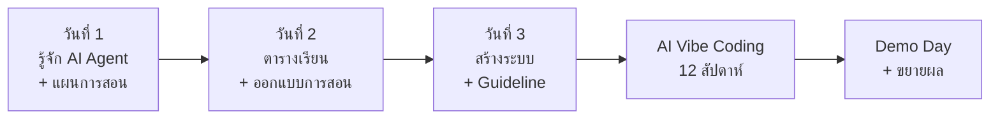

<div align="center">

# AI Agent เพื่อการทำงานของครู

### หลักสูตรอบรม 3 วัน + โครงการต่อเนื่อง **AI Vibe Coding**

*ลดภาระงานเอกสาร เพิ่มเวลาให้การสอน*


[ข้อเสนอโครงการ](docs/01-proposal.md) ·
[เนื้อหาหลักสูตร](docs/02-curriculum.md) ·
[กำหนดการ 3 วัน](docs/03-schedule.md)

</div>

---

## เกี่ยวกับโครงการ

ชุดเอกสารนี้ออกแบบหลักสูตรอบรมครูให้ใช้ **AI Agent** (Claude Cowork, Claude Code, Codex และเครื่องมืออื่น) ช่วยงานครูอย่างเป็นระบบ ได้แก่ แผนการสอน การจัดตารางเรียน การออกแบบการสอน ข้อสอบและแบบประเมิน และการสร้างระบบเบื้องต้นเพื่อลดงานซ้ำ จากนั้นต่อยอดด้วยโครงการ **AI Vibe Coding** 12 สัปดาห์ที่ให้ครูสร้างระบบใช้งานจริงในแผนก

> **แนวคิดหลัก:** ไม่ได้สอนแค่ "วิธีคุยกับ AI" แต่สอน **"วิธีมอบหมายงานให้ AI ทำอย่างเป็นระบบ"** โดยครูเป็นผู้ตรวจและตัดสินใจขั้นสุดท้ายเสมอ

## ภาพรวมโดยสรุป

| หัวข้อ | รายละเอียด |
|---|---|
| รูปแบบ | Workshop เน้นลงมือทำ สัดส่วนปฏิบัติ ≥ 70% |
| ระยะเวลา | 3 วัน (18 ชั่วโมง) + โครงการต่อเนื่อง 12 สัปดาห์ |
| ผู้เข้าอบรม | ครูผู้สอน 20–30 คนต่อรุ่น (ไม่ต้องมีพื้นฐานเขียนโปรแกรม) |
| ผลลัพธ์ต่อคน | แผนการสอน · ชุดสื่อ/ข้อสอบ/Rubric · ระบบเล็ก 1 ชิ้น · แผนนำไปใช้ 30 วัน |
| ผลลัพธ์ต่อแผนก | Guideline การใช้ AI · แม่แบบเอกสารกลาง · ระบบช่วยงานครู ≥ 5 ระบบ · ครูแกนนำ ≥ 5 คน |

## เส้นทางการเรียนรู้



| วัน | ธีม | เครื่องมือหลัก | ผลงานสิ้นวัน |
|:-:|---|---|---|
| 1 | รู้จัก AI Agent + แผนการสอน | Claude Cowork | แผนการจัดการเรียนรู้ 1 รายวิชา |
| 2 | ตารางเรียน + ออกแบบการสอน | Cowork + Claude Code เบื้องต้น | ตารางสอนที่ตรวจเงื่อนไขได้ + ชุดสื่อ 1 หน่วย |
| 3 | สร้างระบบช่วยงานครู + Guideline | Claude Code (เทียบ Codex) | ระบบเล็ก 1 ชิ้น + ร่าง Guideline แผนก |

## โครงสร้างเอกสารใน Repository

```text
.
├── README.md                  ← ไฟล์นี้
├── docs/
│   ├── 01-proposal.md         ← ข้อเสนอโครงการสำหรับหัวหน้าแผนก (ภาพรวม งบ ความเสี่ยง KPI)
│   ├── 02-curriculum.md       ← เนื้อหาหลักสูตรทุก Module (เป้าหมาย แนวคิด Lab เกณฑ์ผ่าน)
│   └── 03-schedule.md         ← กำหนดการรายชั่วโมง 3 วัน + Checklist เตรียมงาน + แผนสำรอง
└── LICENSE                    ← (เพิ่มตามที่ต้องการ)
```

## อ่านเริ่มจากตรงไหน

| คุณคือ | เริ่มที่ | เพราะ |
|---|---|---|
| ผู้บริหาร / หัวหน้าแผนก | [01-proposal.md](docs/01-proposal.md) | สรุปเหตุผล ผลลัพธ์ งบ ความเสี่ยง และสิ่งที่ขออนุมัติ |
| วิทยากร / ผู้ช่วย | [02-curriculum.md](docs/02-curriculum.md) → [03-schedule.md](docs/03-schedule.md) | เนื้อหา Lab และเวลาที่ใช้จริง |
| ฝ่ายประสานงาน | [03-schedule.md](docs/03-schedule.md) | Checklist เตรียมงาน อุปกรณ์ แผนสำรอง |
| ครูผู้เข้าอบรม | [03-schedule.md](docs/03-schedule.md) หัวข้อ Pre-work ในข้อเสนอ | รู้ว่าต้องเตรียมอะไรล่วงหน้า |

## หลักการสำคัญ (ครูทุกคนควรจำ)

1. **AI คือผู้ช่วย ครูคือผู้ตัดสินใจ** — ตรวจงานทุกชิ้นก่อนใช้
2. **งานที่ต้องแม่นยำ ให้ AI เขียนโปรแกรมทำ อย่าให้ AI เดา** — เช่น ตารางสอน การคำนวณเกรด
3. **ข้อมูลนักเรียนเป็นความลับ** — ปกปิดตัวตนก่อนส่งให้ AI ภายนอกทุกครั้ง

## ตัวชี้วัดความสำเร็จ

| ตัวชี้วัด | เป้าหมาย |
|---|---|
| ผู้เข้าอบรมผ่านเกณฑ์ | ≥ 85% |
| เวลาเขียนแผนการสอนลดลง | ≥ 50% (วัดจริงก่อน–หลัง) |
| ครูใช้ AI ต่อเนื่องหลังอบรม 1 เดือน | ≥ 70% |
| ระบบที่ใช้งานจริงใน 1 ภาคเรียน | ≥ 5 ระบบ |
| ความพึงพอใจ | ≥ 4.50 / 5.00 |
| เหตุการณ์ข้อมูลส่วนบุคคลรั่วไหลจากการใช้ AI | 0 ครั้ง |

> ตัวเลขเป้าหมายเป็นข้อเสนอเริ่มต้นของโครงการ ไม่ใช่ผลการวิจัย ผลจริงจะได้จากการวัดเวลาก่อน–หลังของผู้เข้าอบรม

## Roadmap

- [x] ออกแบบหลักสูตรและข้อเสนอโครงการ
- [ ] หัวหน้าแผนกพิจารณาอนุมัติหลักการ
- [ ] จัดทำรายละเอียดงบประมาณ
- [ ] กำหนดวันอบรมและเปิดรับสมัคร
- [ ] จัดอบรมรุ่นที่ 1 (3 วัน)
- [ ] เริ่มโครงการ AI Vibe Coding 12 สัปดาห์
- [ ] Demo Day และรายงานผลต่อผู้บริหาร
- [ ] ขยายผลสู่แผนกอื่น

## ข้อควรระวัง

- **ฟีเจอร์ ราคา และเงื่อนไขการใช้งานของเครื่องมือ AI เปลี่ยนแปลงเร็ว** ควรตรวจสอบข้อมูลล่าสุดจากผู้ให้บริการก่อนอบรม 2–3 สัปดาห์
- **ห้ามนำข้อมูลส่วนบุคคลจริงของนักเรียนหรือเอกสารลับของทางราชการ** ไปใช้ในการอบรมหรือส่งขึ้นบริการ AI ภายนอก ใช้ข้อมูลจำลองหรือข้อมูลที่ปกปิดแล้วเท่านั้น
- เอกสารนี้เป็นแผนข้อเสนอ ไม่ใช่คำแนะนำด้านกฎหมาย ควรให้ผู้รับผิดชอบด้านข้อมูลส่วนบุคคล (PDPA) ของสถานศึกษาตรวจแนวปฏิบัติก่อนใช้จริง

## การมีส่วนร่วม

ยินดีรับข้อเสนอแนะจากครู วิทยากร และผู้สนใจ:

1. เปิด **Issue** เพื่อแจ้งข้อผิดพลาดหรือเสนอหัวข้อใหม่
2. สร้าง **Pull Request** โดยแก้เอกสารใน `docs/` และอธิบายเหตุผลสั้นๆ
3. หากเพิ่ม Lab หรือแม่แบบ ให้ใช้ข้อมูลจำลองเท่านั้น

## ผู้จัดทำ

พิฆเนศ แสงสะเดาะ — งานเครือข่ายและโครงสร้างพื้นฐานไอที

## สัญญาอนุญาต

เนื้อหาเอกสารเผยแพร่ภายใต้ [Creative Commons Attribution-ShareAlike 4.0 (CC BY-SA 4.0)](https://creativecommons.org/licenses/by-sa/4.0/) — นำไปใช้ ดัดแปลง และแจกจ่ายต่อได้ โดยต้องให้เครดิตและเผยแพร่ต่อด้วยสัญญาอนุญาตเดียวกัน
*(เปลี่ยนได้ตามนโยบายของสถานศึกษา)*
